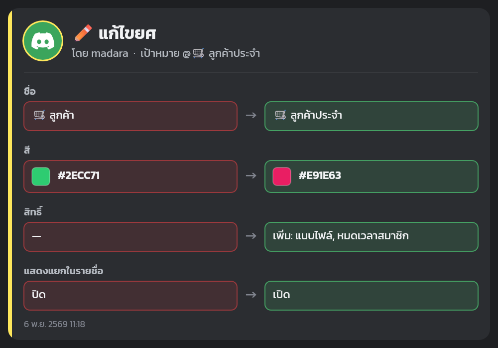
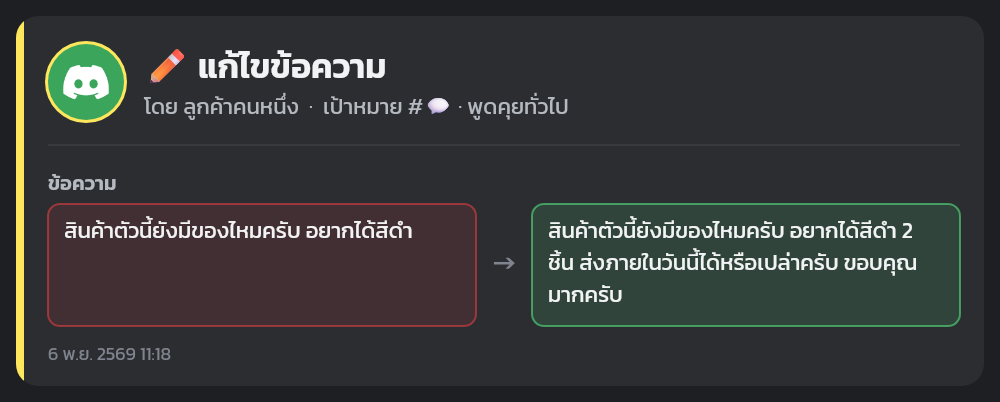
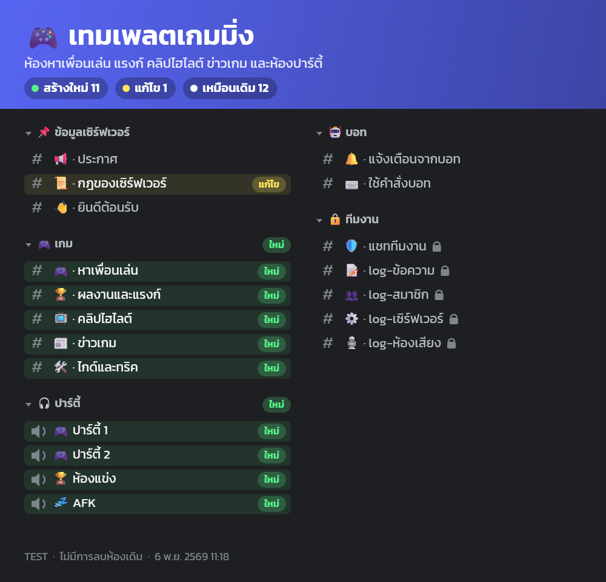
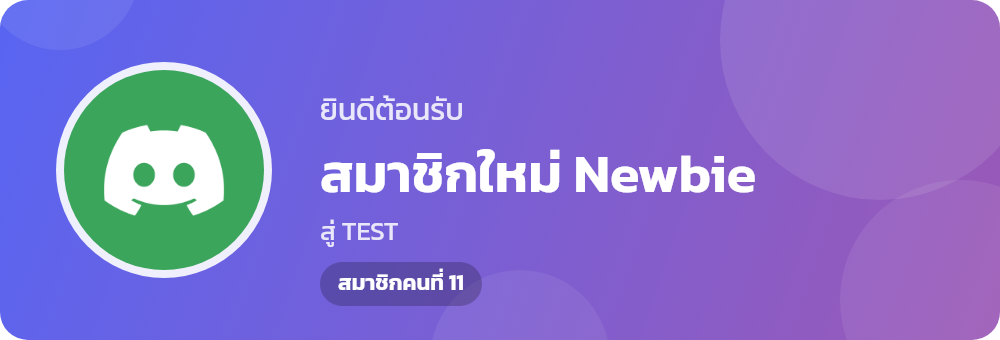
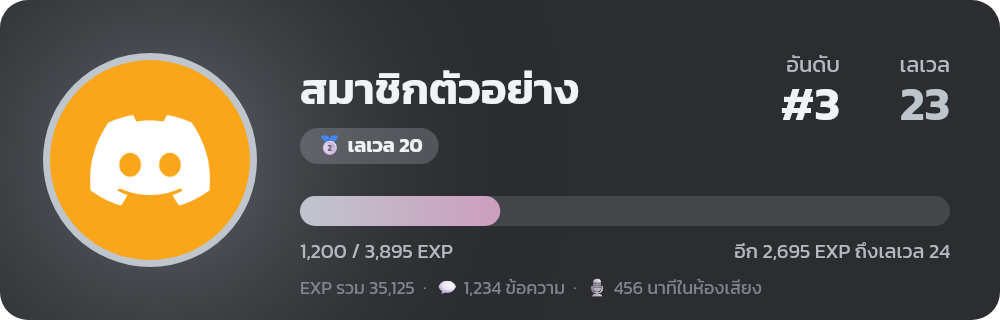
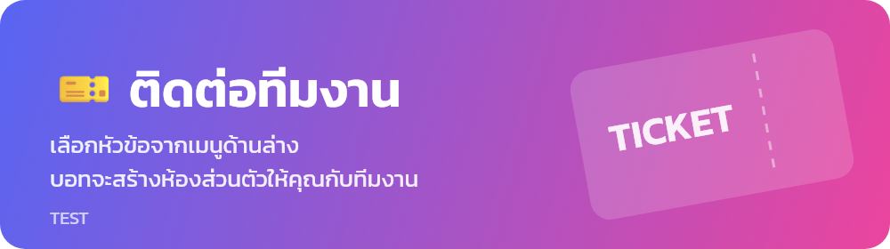

<div align="center">

# 🏪 Builder Discord

**A Discord bot for shop servers. Set up channels and roles with one command, with activity logging, music, and moderation tools built in.**

[](https://nodejs.org/)
[](https://discord.js.org/)
[](#-commands)
[](#-channel-templates)
[](#-10-role-levels)

[ภาษาไทย](README.md) · **English**

</div>

---

## ✨ Features

| | |
|---|---|
| ⭐ **Leveling** | Earn XP from chatting and voice, up to level 100 with a steeper curve each level, a reward role every 10 levels, and a congratulation card on level-up. |
| 🎫 **Tickets** | Members pick a topic from a panel and get a private channel with staff, with claim and close buttons and an HTML chat transcript. |
| 🧩 **Channel templates** | Build a whole server with `/template`. Pick one of 4 templates, see a preview image, and confirm before anything is created. |
| 🏗️ **Automated server setup** | Creates categories and channels with emoji, topics, and per-channel permissions. Safe to re-run: no duplicates, and existing channels are never deleted. |
| 🎭 **10 role levels** | Permissions grow with each level, and new members get a starter role automatically. |
| 🖼️ **Image log cards** | Every change is drawn as a "before → after" card with the editor's avatar, role colors, icons, and readable permission names. |
| 📝 **Activity logging** | Records edited and deleted messages, member, voice, and server changes. Every entry starts with a plain Thai sentence saying who did what, followed by a list of what changed. |
| 🎵 **Music** | Plays from SoundCloud with queue, loop, and shuffle. Supports Discord's DAVE voice encryption. |
| 🛡️ **Moderation** | Kick, ban, timeout, clear messages, set levels, and post announcements. Staff can't act on equal or higher roles. |
| 👋 **Welcome and notices** | Greets new members with an image card and reports bot status and server boosts. |

## 🖼️ Screenshots

Card text is in Thai by default.

<table>
<tr>
<td width="50%"><b>Role change card</b><br></td>
<td width="50%"><b>Message edit card</b><br></td>
</tr>
<tr>
<td><b>Template preview</b><br></td>
<td><b>Welcome card</b><br></td>
</tr>
<tr>
<td><b>Rank card (/rank)</b><br></td>
<td><b>Level-up card</b><br></td>
</tr>
<tr>
<td colspan="2"><b>Ticket panel banner</b><br></td>
</tr>
</table>

## ⭐ Leveling

| XP source | Amount |
|---|---|
| 💬 Sending a message | 15-25 XP (once per minute, to prevent spam) |
| 🎙️ Being in voice with at least one other person | 10 XP per minute (not in the AFK channel or while deafened) |

The XP needed for each level is `5 × level² + 50 × level + 100`, so it gets harder as you go.

| Level | XP to next level | Total XP needed |
|---:|---:|---:|
| 1 | 155 | 100 |
| 10 | 1,100 | 4,675 |
| 50 | 15,100 | 268,375 |
| 100 | Max | 1,899,250 |

Every 10 levels gives a reward role. The bot adds the new one and removes the old one: 🥉 10 · 🥈 20 · 🥇 30 · 🏅 40 · 🎖️ 50 · 💠 60 · 🔮 70 · 🔥 80 · 🌟 90 · 🏆 100

On level-up, the bot posts a congratulation in **🆙 Level-up**, mentions the member, and attaches a card.

## 🎫 Tickets

1. A member picks a topic from the menu in **🎫 Open a ticket**: 🛒 Order, 💳 Payment, 🛠️ Problem, or 💬 Other.
2. They fill in optional details in a pop-up form.
3. The bot creates `🎫・0001-username` in **📂 Open tickets**, visible only to that member and staff roles (Lv.5 and up), and pings 🎧 Customer support.
4. Staff press **🙋 Claim** to show who's handling it.
5. The member or staff press **🔒 Close**. The bot posts a summary and an HTML transcript to **🎫 Ticket log**, then deletes the channel after 5 seconds.

- Each member can have one open ticket at a time.
- Edit the topics in `TICKET_TYPES` in [`src/tickets.js`](src/tickets.js), then run `/ticket panel` to refresh the panel.
- Images and files in a transcript may stop loading after the channel is deleted, because Discord attachment links expire.

## 🧩 Channel templates

| Template | ID | Template-specific channels |
|---|---|---|
| 🛒 Shop | `shop` | Products, promotions, ordering, payment, reviews, questions, and chat |
| 🌐 Community | `community` | Chat, introductions, media, artwork, events, and lounge voice rooms |
| 🎮 Gaming | `gaming` | Looking for group, ranks, clips, game news, guides, and party rooms |
| 📚 Study | `study` | Homework help, notes, exam schedule, resources, and study rooms |

Every template shares the 📌 Server info, 🎫 Support, 📂 Tickets, 🤖 Bot, and 🔒 Staff categories, because the bot relies on those channels.

- `/template apply` shows a preview image that marks **new** and **changed** channels, then waits for you to confirm.
- Templates never delete channels. Channels outside the template are left alone.
- You can apply several templates to one server. Shared categories aren't created twice.

Edit or add templates in [`src/templates.js`](src/templates.js).

## 🗂️ Channel layout (Shop template)

Channel names are in Thai by default.

```text
📌 Server info    📢 Announcements · 📜 Rules · 👋 Welcome
🛒 Shop           🛍️ Products · 🔥 Promotions · 🧾 How to order · 💳 Payment
                  ⭐ Reviews · ❓ Questions
💬 Chat           💬 General · 📷 Media · 💡 Suggestions · 🔊 Voice chat · 🎵 Music
🎫 Support        🎫 Open a ticket
📂 Open tickets   (the bot creates ticket channels here)
🤖 Bot            🔔 Bot notices · ⌨️ Bot commands · 🆙 Level-up
🔒 Staff          🛡️ Staff chat · 📝 Message log · 👥 Member log
                  ⚙️ Server log · 🎙️ Voice log · 🎫 Ticket log
```

To rename or add channels, edit [`src/templates.js`](src/templates.js) and run `npm run setup` again.

## 🎭 10 role levels

| Level | Role | Adds to the level below |
|---:|---|---|
| 10 | 👑 Shop owner | Manage roles, manage server |
| 9 | 💎 Manager | Manage channels, webhooks |
| 8 | ⚔️ Admin | Ban, mention @everyone, manage emoji and events |
| 7 | 🔨 Moderator | Kick, mute, move voice members, view audit log |
| 6 | 🛡️ Staff | Time out members, change others' nicknames |
| 5 | 🎧 Customer support | Manage messages and threads |
| 4 | 🌟 VIP customer | Private threads, voice messages, soundboard |
| 3 | 🛒 Customer | Create threads, external stickers, create invites |
| 2 | ✅ Member | Attach files, stream, external emoji |
| 1 | 🌱 Newcomer | Send messages, react, join and speak in voice |

Level 5 and above can see the 🔒 Staff category and log channels.

## 💬 Commands

<details open>
<summary><b>📌 General</b></summary>

| Command | Description |
|---|---|
| `/help` | List all commands |
| `/ping` | Check response time |
| `/serverinfo` | Show server info |
| `/userinfo` | Show member info |
| `/avatar` | Show a profile picture |
| `/poll` | Create a poll |
| `/dice` | Roll a die |
| `/coinflip` | Flip a coin |

</details>

<details open>
<summary><b>⭐ Leveling</b></summary>

| Command | Description | Who can use it |
|---|---|---|
| `/rank` | Show your level, XP, and rank as an image card | Everyone |
| `/rank user:` | Show someone else's level | Admins |
| `/leaderboard` | Show everyone's ranking | Admins |
| `/xp setlevel` | Set a member's level, including your own | Admins |
| `/xp add` | Add or remove XP | Admins |
| `/xp reset` | Reset XP to 0 | Admins |

</details>

<details open>
<summary><b>🎵 Music</b></summary>

| Command | Description |
|---|---|
| `/play` | Play by song name or SoundCloud link |
| `/skip` | Skip the current song |
| `/stop` | Stop, clear the queue, and leave |
| `/pause` · `/resume` | Pause · Resume |
| `/queue` | Show the queue |
| `/nowplaying` | Show the current song |
| `/shuffle` | Shuffle the queue |
| `/loop` | Set the loop mode |

</details>

<details open>
<summary><b>🎫 Tickets</b></summary>

| Command | Description | Who can use it |
|---|---|---|
| `/ticket close` | Close this ticket, with an optional reason | Ticket owner or staff |
| `/ticket add` | Add someone to this ticket | Staff |
| `/ticket remove` | Remove someone from this ticket | Staff |
| `/ticket panel` | Post or refresh the ticket panel | Admins |

</details>

<details open>
<summary><b>🛡️ Staff</b></summary>

| Command | Description | Minimum role |
|---|---|---:|
| `/clear` | Delete recent messages | Lv.5 |
| `/announce` | Post in the announcements channel | Lv.5 |
| `/timeout` · `/untimeout` | Time out · Remove timeout | Lv.6 |
| `/kick` | Kick a member | Lv.7 |
| `/ban` · `/unban` | Ban · Unban | Lv.8 |
| `/slowmode` | Set channel slowmode | Lv.9 |
| `/setlevel` | Set a member's role level, 1-10 | Lv.10 |

</details>

<details open>
<summary><b>🧩 Templates (admins)</b></summary>

| Command | Description |
|---|---|
| `/template list` | List all templates |
| `/template preview` | Preview which channels would be created or changed |
| `/template apply` | Build channels from a template after you confirm |

</details>

## 🚀 Getting started

### Requirements

- [Node.js](https://nodejs.org/) 20.6 or later
- A bot from the [Discord Developer Portal](https://discord.com/developers/applications) with **Server Members Intent** and **Message Content Intent** turned on

### 🔑 Bot permissions (read before the first invite)

**1. Turn on intents in the [Developer Portal](https://discord.com/developers/applications)** under **Bot** › Privileged Gateway Intents.

| Intent | Used for |
|---|---|
| Server Members Intent | Welcoming members, assigning roles, and member logs |
| Message Content Intent | Logging edited and deleted messages, and XP from chatting |

Without them, the bot can't connect.

**2. Invite the bot with all permissions.** The easiest way is to run `npm run setup` and open the link it prints. Or replace `YOUR_CLIENT_ID` with your bot's Application ID:

```text
https://discord.com/oauth2/authorize?client_id=YOUR_CLIENT_ID&scope=bot&permissions=76411762634743
```

| Permission | Used by |
|---|---|
| Manage Roles | Creating the 10 role levels and level roles, and assigning or removing roles |
| Manage Channels | `/template`, tickets, and `/slowmode` |
| View Audit Log | Logging who changed what in the server |
| Manage Messages | `/clear` |
| Kick, Ban, and Moderate Members | `/kick` `/ban` `/timeout` |
| View Channels, Send Messages, Embed Links, Attach Files, Read Message History | Every feature, including image cards and transcripts |
| Connect and Speak | Music |
| Mention Everyone | Pinging the support role when a ticket opens |
| Everything else in the link | The bot can only grant permissions it has, so it needs every permission the 👑 Shop owner role gets |

The bot doesn't need Administrator. It also works with Administrator, but then a leaked token gives full control of the server.

**3. Drag the bot's role to the top** in **Server Settings › Roles**. The bot can only manage roles below its own, so a low bot role can't hand out level roles or kick higher members.

### Install

```bash
git clone https://github.com/madara1150/builder-discord.git
```

```bash
cd builder-discord
```

```bash
npm install
```

Copy `.env.example` to `.env` and fill it in:

```env
DISCORD_TOKEN=your-bot-token
GUILD_NAME=your-server-name
```

### Set up channels and roles

```bash
npm run setup
```

If the bot isn't in the server or lacks permissions, this prints an invite link. Open it, then run the command again.

### Start the bot

```bash
npm start
```

## 📜 Scripts

| Script | Description |
|---|---|
| `npm run preview` | List roles and channels without connecting to Discord |
| `npm run setup` | Create or update roles and channels from the Shop template. Never deletes existing channels. |
| `npm run setup -- --template=gaming` | Use another template (`shop` `community` `gaming` `study`) |
| `npm run setup -- --restrict-everyone` | Same as above, then reduce `@everyone` to read-only |
| `npm start` | Start the bot and register slash commands |

## 📁 Project structure

```text
src/
├── bot.js            Bot startup and command handling
├── logger.js         Formats and sends log entries
├── log-events.js     Turns server events into log entries
├── setup.js          Creates roles and channels from the terminal
├── builder.js        Plans and builds channels from a template
├── templates.js      All channel templates
├── layout.js         The 10 role levels
├── store.js          Remembers which channel is which (channels.json)
├── roles.js          Assigns and changes roles
├── music.js          Music playback
├── tickets.js        Ticket system
├── xp.js             Leveling and XP
├── ui/
│   ├── cards.js      Draws the image cards
│   ├── changes.js    Turns changes into readable Thai text
│   ├── transcript.js Builds the ticket chat transcript
│   └── time.js       Thai-readable durations
└── commands/
    ├── index.js      Command list and /help
    ├── general.js    General commands
    ├── levels.js     Leveling commands
    ├── music.js      Music commands
    ├── moderation.js Staff commands
    ├── template.js   Template commands
    └── ticket.js     Ticket commands
```

## ⚠️ Good to know

- **XP is stored in `levels.json`.** Moving servers or deleting the file loses all XP, so back it up.
- **Level roles are created at the bottom of the role list.** Higher roles can hide their color. Drag them up if you want the color to show.

- **The bot must stay running.** Events that happen while it's off aren't logged. With `--restrict-everyone`, new members can't type until the bot is back and assigns their role.
- **Music plays from SoundCloud only.** YouTube isn't supported.
- **Emoji in image cards** use the host's emoji font. On Linux without one, cards drop emoji automatically. Install `fonts-noto-color-emoji` to show them.
- **The bot can't reorder roles.** If you add a role, drag it into place in Discord.
- **`--restrict-everyone` affects existing members.** Anyone without a level gets ✅ Member, and the old permissions are saved to `everyone-backup.txt`.
- **Never commit `.env`.** If your token leaks, reset it in the Developer Portal right away.
