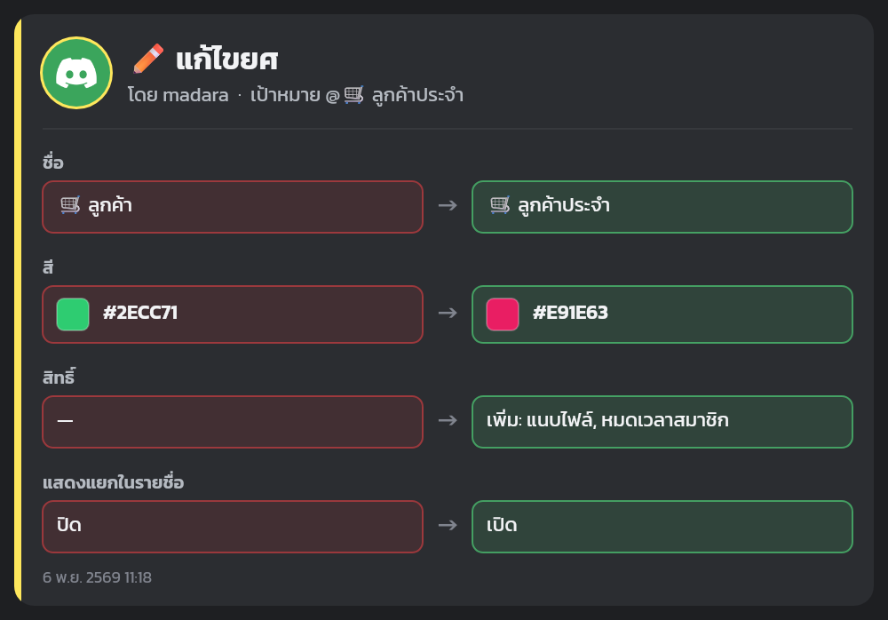
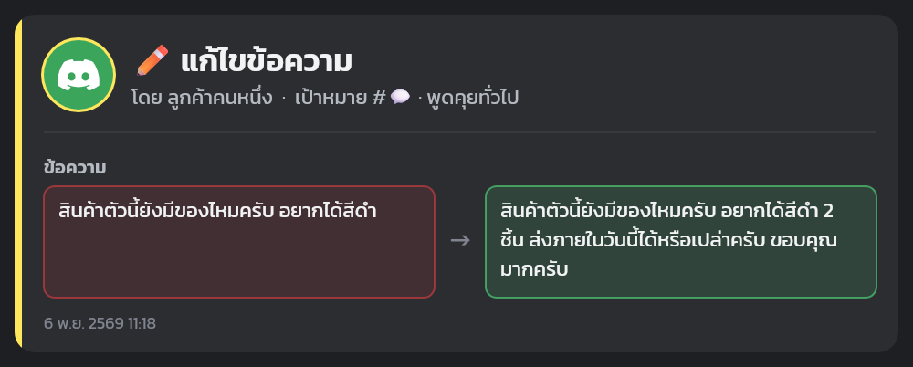
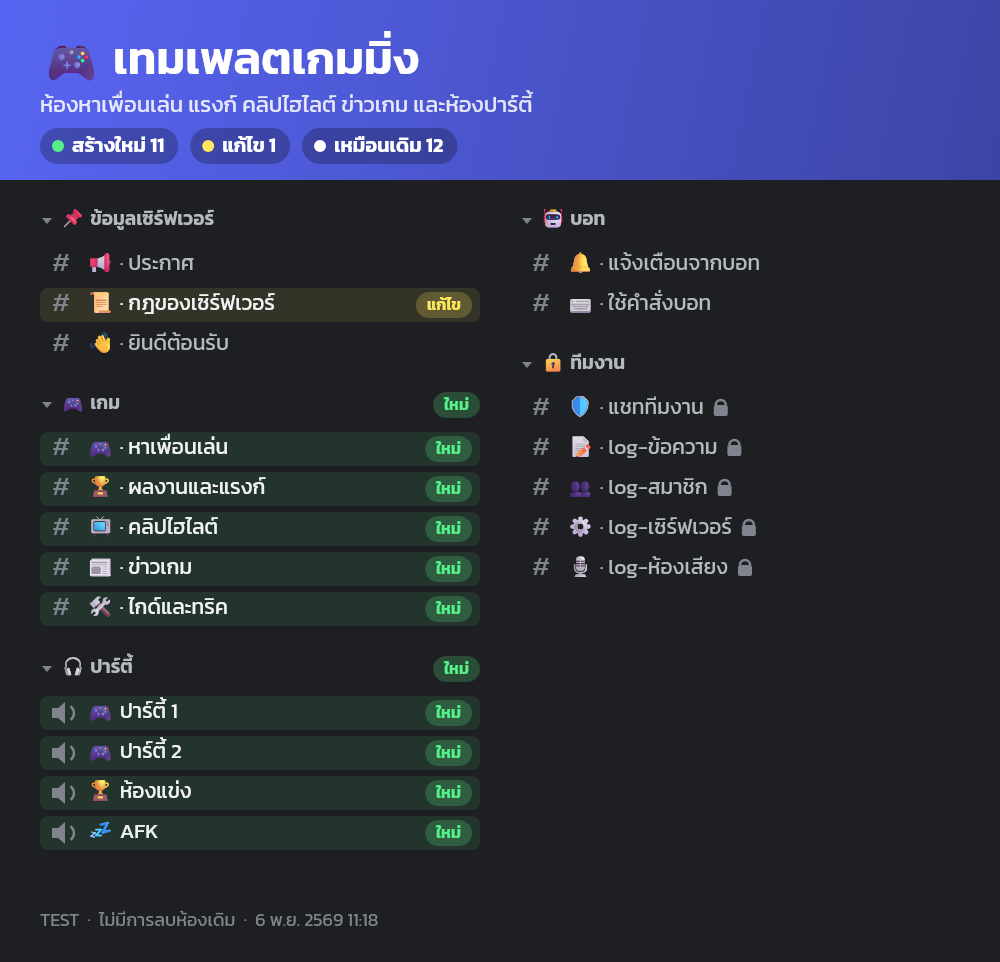
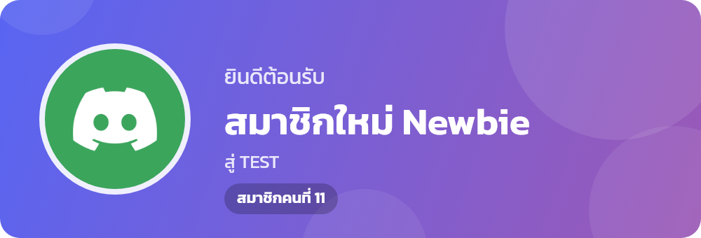
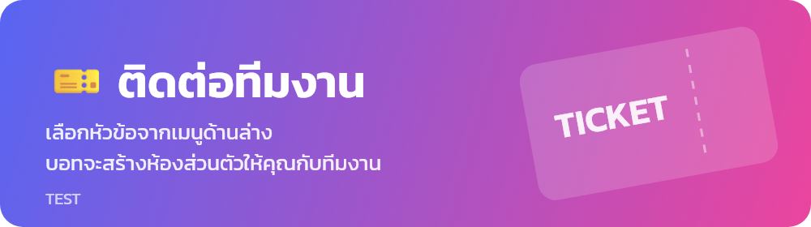

<div align="center">

# 🏪 Builder Discord

**บอท Discord สำหรับเซิร์ฟเวอร์ร้านค้า จัดห้องและยศให้ครบในคำสั่งเดียว พร้อมระบบ Log เพลง และเครื่องมือดูแลเซิร์ฟเวอร์**

[](https://nodejs.org/)
[](https://discord.js.org/)
[](#-คำสั่ง)
[](#-เทมเพลตห้อง)
[](#-ยศ-10-ระดับ)

**ภาษาไทย** · [English](README.en.md)

</div>

---

## ✨ ความสามารถ

| | |
|---|---|
| 🎫 **ระบบทิกเก็ต** | ลูกค้าเลือกหัวข้อจากแผง แล้วบอทสร้างห้องส่วนตัวกับทีมงาน มีปุ่มรับเรื่องและปิด และเก็บประวัติแชทเป็นไฟล์ HTML |
| 🧩 **เทมเพลตห้อง** | สร้างห้องทั้งเซิร์ฟเวอร์ด้วย `/template` เลือกได้ 4 แบบ ดูภาพตัวอย่างและยืนยันก่อนสร้างจริง |
| 🏗️ **จัดเซิร์ฟเวอร์อัตโนมัติ** | สร้างหมวดและห้อง พร้อมอิโมจิ คำอธิบาย และสิทธิ์ของแต่ละห้อง รันซ้ำได้โดยไม่สร้างห้องซ้ำและไม่ลบห้องเดิม |
| 🎭 **ยศ 10 ระดับ** | สิทธิ์เพิ่มขึ้นตามระดับ แจกยศให้คนเข้าใหม่อัตโนมัติ |
| 🖼️ **Log แบบการ์ดรูปภาพ** | ทุกการแก้ไขแสดงเป็นการ์ด "ก่อน → หลัง" มีรูปโปรไฟล์ของคนทำ สีของยศ รูปไอคอน และชื่อสิทธิ์ภาษาไทย |
| 📝 **ระบบ Log** | บันทึกข้อความที่แก้หรือลบ สมาชิก ห้องเสียง และการตั้งค่าเซิร์ฟเวอร์ ทุกรายการขึ้นต้นด้วยประโยคภาษาไทยว่าใครทำอะไร ตามด้วยรายการสิ่งที่เปลี่ยน |
| 🎵 **เล่นเพลง** | เล่นจาก SoundCloud มีคิว วนซ้ำ สลับเพลง และรองรับการเข้ารหัสเสียง DAVE |
| 🛡️ **ดูแลเซิร์ฟเวอร์** | เตะ แบน หมดเวลา ลบข้อความ ตั้งระดับยศ ลงประกาศ โดยจัดการคนยศเท่ากันหรือสูงกว่าไม่ได้ |
| 👋 **ต้อนรับและแจ้งเตือน** | ทักทายสมาชิกใหม่ด้วยการ์ดรูปภาพ แจ้งสถานะบอท และแจ้งเมื่อมีคนบูสต์ |

## 🖼️ ตัวอย่าง

<table>
<tr>
<td width="50%"><b>การ์ดแก้ไขยศ</b><br></td>
<td width="50%"><b>การ์ดแก้ไขข้อความ</b><br></td>
</tr>
<tr>
<td><b>ตัวอย่างเทมเพลตก่อนสร้าง</b><br></td>
<td><b>การ์ดต้อนรับสมาชิกใหม่</b><br></td>
</tr>
<tr>
<td colspan="2"><b>แบนเนอร์แผงเปิดทิกเก็ต</b><br></td>
</tr>
</table>

## 🎫 ระบบทิกเก็ต

1. ลูกค้าเลือกหัวข้อจากเมนูในห้อง **🎫・เปิดทิกเก็ต** ได้แก่ 🛒 สั่งซื้อสินค้า, 💳 แจ้งชำระเงิน, 🛠️ แจ้งปัญหา หรือ 💬 เรื่องอื่นๆ
2. กรอกรายละเอียดในหน้าต่างที่เด้งขึ้น โดยจะเว้นว่างก็ได้
3. บอทสร้างห้อง `🎫・0001-ชื่อผู้ใช้` ในหมวด **📂 ทิกเก็ตที่เปิดอยู่** ที่เห็นแค่ลูกค้ากับยศทีมงาน (Lv.5 ขึ้นไป) และแท็ก 🎧 ฝ่ายบริการลูกค้า
4. ทีมงานกด **🙋 รับเรื่อง** เพื่อบอกว่าใครดูแลเรื่องนี้
5. ลูกค้าหรือทีมงานกด **🔒 ปิดทิกเก็ต** บอทจะส่งสรุปพร้อมไฟล์ประวัติแชท (HTML) เข้าห้อง **🎫・log-ทิกเก็ต** แล้วลบห้องใน 5 วินาที

- เปิดได้คนละ 1 ทิกเก็ตในเวลาเดียวกัน
- แก้หัวข้อทิกเก็ตได้ที่ `TICKET_TYPES` ใน [`src/tickets.js`](src/tickets.js) แล้วใช้ `/ticket panel` เพื่ออัปเดตแผง
- ลิงก์รูปและไฟล์แนบในประวัติแชทอาจเปิดไม่ได้หลังห้องถูกลบ เพราะ Discord ตั้งเวลาหมดอายุของลิงก์

## 🧩 เทมเพลตห้อง

| เทมเพลต | ID | ห้องเฉพาะของเทมเพลต |
|---|---|---|
| 🛒 ร้านค้า | `shop` | สินค้า โปรโมชัน วิธีสั่งซื้อ ชำระเงิน รีวิว สอบถาม และห้องพูดคุย |
| 🌐 คอมมูนิตี้ | `community` | แชท แนะนำตัว รูปและคลิป ผลงาน กิจกรรม และห้องเสียงนั่งเล่น |
| 🎮 เกมมิ่ง | `gaming` | หาเพื่อนเล่น แรงก์ คลิปไฮไลต์ ข่าวเกม ไกด์ และห้องปาร์ตี้ |
| 📚 ติวหนังสือ | `study` | ถามการบ้าน สรุปเนื้อหา ตารางสอบ แหล่งเรียนรู้ และห้องติว |

ทุกเทมเพลตมีหมวด 📌 ข้อมูลเซิร์ฟเวอร์ 🎫 ติดต่อทีมงาน 📂 ทิกเก็ต 🤖 บอท และ 🔒 ทีมงานร่วมกัน เพราะบอทต้องใช้ห้องเหล่านี้

- `/template apply` จะแสดงภาพตัวอย่างที่ทำเครื่องหมายห้อง **ใหม่** และห้องที่จะ **แก้ไข** แล้วรอให้กดยืนยันก่อน
- เทมเพลตไม่ลบห้องเดิม ห้องที่ไม่อยู่ในเทมเพลตจะไม่ถูกแตะ
- ใช้หลายเทมเพลตในเซิร์ฟเวอร์เดียวกันได้ หมวดที่ใช้ร่วมกันจะไม่ถูกสร้างซ้ำ

แก้หรือเพิ่มเทมเพลตได้ที่ [`src/templates.js`](src/templates.js)

## 🗂️ โครงสร้างห้อง (เทมเพลตร้านค้า)

```text
📌 ข้อมูลเซิร์ฟเวอร์    📢 ประกาศ · 📜 กฎของเซิร์ฟเวอร์ · 👋 ยินดีต้อนรับ
🛒 ร้านค้า             🛍️ สินค้าทั้งหมด · 🔥 โปรโมชัน · 🧾 วิธีสั่งซื้อ · 💳 ช่องทางชำระเงิน
                       ⭐ รีวิวจากลูกค้า · ❓ สอบถามสินค้า
💬 พูดคุย              💬 พูดคุยทั่วไป · 📷 แชร์รูปภาพ · 💡 เสนอแนะ · 🔊 พูดคุย · 🎵 ฟังเพลง
🎫 ติดต่อทีมงาน        🎫 เปิดทิกเก็ต
📂 ทิกเก็ตที่เปิดอยู่    (บอทสร้างห้องทิกเก็ตไว้ที่นี่)
🤖 บอท                🔔 แจ้งเตือนจากบอท · ⌨️ ใช้คำสั่งบอท
🔒 ทีมงาน              🛡️ แชททีมงาน · 📝 log-ข้อความ · 👥 log-สมาชิก
                       ⚙️ log-เซิร์ฟเวอร์ · 🎙️ log-ห้องเสียง · 🎫 log-ทิกเก็ต
```

แก้ชื่อห้องหรือเพิ่มห้องได้ที่ [`src/templates.js`](src/templates.js) แล้วรัน `npm run setup` อีกครั้ง

## 🎭 ยศ 10 ระดับ

| ระดับ | ยศ | สิทธิ์ที่เพิ่มจากระดับล่าง |
|---:|---|---|
| 10 | 👑 เจ้าของร้าน | จัดการยศ จัดการเซิร์ฟเวอร์ |
| 9 | 💎 ผู้จัดการ | จัดการห้อง Webhook |
| 8 | ⚔️ แอดมิน | แบน แท็ก @everyone จัดการอิโมจิและกิจกรรม |
| 7 | 🔨 ผู้ดูแล | เตะ ปิดเสียง ย้ายห้องเสียง ดูบันทึกการตรวจสอบ |
| 6 | 🛡️ ทีมงาน | หมดเวลาสมาชิก เปลี่ยนชื่อเล่นคนอื่น |
| 5 | 🎧 ฝ่ายบริการลูกค้า | จัดการข้อความและเธรด |
| 4 | 🌟 ลูกค้า VIP | เธรดส่วนตัว ข้อความเสียง ซาวด์บอร์ด |
| 3 | 🛒 ลูกค้า | สร้างเธรด สติกเกอร์นอกเซิร์ฟเวอร์ สร้างลิงก์เชิญ |
| 2 | ✅ สมาชิก | แนบไฟล์ สตรีม อิโมจินอกเซิร์ฟเวอร์ |
| 1 | 🌱 ผู้มาใหม่ | พิมพ์ กดรีแอคชัน เข้าห้องเสียงและพูด |

ระดับ 5 ขึ้นไปเห็นหมวด 🔒 ทีมงานและห้อง Log

## 💬 คำสั่ง

<details open>
<summary><b>📌 ทั่วไป</b></summary>

| คำสั่ง | คำอธิบาย |
|---|---|
| `/help` | ดูคำสั่งทั้งหมด |
| `/ping` | เช็กความเร็วการตอบสนอง |
| `/serverinfo` | ดูข้อมูลเซิร์ฟเวอร์ |
| `/userinfo` | ดูข้อมูลสมาชิก |
| `/avatar` | ดูรูปโปรไฟล์ |
| `/poll` | สร้างโพล |
| `/dice` | ทอยลูกเต๋า |
| `/coinflip` | โยนเหรียญ |

</details>

<details open>
<summary><b>🎵 เพลง</b></summary>

| คำสั่ง | คำอธิบาย |
|---|---|
| `/play` | เล่นเพลงจากชื่อหรือลิงก์ SoundCloud |
| `/skip` | ข้ามเพลง |
| `/stop` | หยุดเล่น ล้างคิว และออกจากห้อง |
| `/pause` · `/resume` | พักเพลง · เล่นต่อ |
| `/queue` | ดูคิวเพลง |
| `/nowplaying` | ดูเพลงที่กำลังเล่น |
| `/shuffle` | สลับลำดับคิว |
| `/loop` | ตั้งการวนซ้ำ |

</details>

<details open>
<summary><b>🎫 ทิกเก็ต</b></summary>

| คำสั่ง | คำอธิบาย | ใครใช้ได้ |
|---|---|---|
| `/ticket close` | ปิดทิกเก็ตนี้ ใส่เหตุผลได้ | เจ้าของทิกเก็ตหรือทีมงาน |
| `/ticket add` | เพิ่มคนเข้าทิกเก็ตนี้ | ทีมงาน |
| `/ticket remove` | นำคนออกจากทิกเก็ตนี้ | ทีมงาน |
| `/ticket panel` | โพสต์หรือรีเฟรชแผงเปิดทิกเก็ต | แอดมิน |

</details>

<details open>
<summary><b>🛡️ ทีมงาน</b></summary>

| คำสั่ง | คำอธิบาย | ยศขั้นต่ำ |
|---|---|---:|
| `/clear` | ลบข้อความล่าสุด | Lv.5 |
| `/announce` | ลงประกาศในห้อง 📢 | Lv.5 |
| `/timeout` · `/untimeout` | ห้ามพิมพ์ชั่วคราว · ยกเลิก | Lv.6 |
| `/kick` | เตะสมาชิก | Lv.7 |
| `/ban` · `/unban` | แบน · ปลดแบน | Lv.8 |
| `/slowmode` | ตั้งโหมดช้าของห้อง | Lv.9 |
| `/setlevel` | ตั้งยศระดับ 1-10 | Lv.10 |

</details>

<details open>
<summary><b>🧩 เทมเพลต (แอดมิน)</b></summary>

| คำสั่ง | คำอธิบาย |
|---|---|
| `/template list` | ดูเทมเพลตทั้งหมด |
| `/template preview` | ดูภาพตัวอย่างว่าจะสร้างหรือแก้ห้องอะไรบ้าง |
| `/template apply` | สร้างห้องตามเทมเพลต หลังกดยืนยัน |

</details>

## 🚀 เริ่มต้นใช้งาน

### สิ่งที่ต้องมี

- [Node.js](https://nodejs.org/) 20.6 ขึ้นไป
- บอทจาก [Discord Developer Portal](https://discord.com/developers/applications) ที่เปิด **Server Members Intent** และ **Message Content Intent** แล้ว

### ติดตั้ง

```bash
git clone https://github.com/madara1150/builder-discord.git
```

```bash
cd builder-discord
```

```bash
npm install
```

คัดลอก `.env.example` เป็น `.env` แล้วกรอกค่า:

```env
DISCORD_TOKEN=โทเค็นของบอท
GUILD_NAME=ชื่อเซิร์ฟเวอร์
```

### จัดห้องและยศ

```bash
npm run setup
```

ถ้าบอทยังไม่อยู่ในเซิร์ฟเวอร์หรือสิทธิ์ไม่ครบ คำสั่งนี้จะแสดงลิงก์เชิญให้กด แล้วรันซ้ำอีกครั้ง

### เปิดบอท

```bash
npm start
```

## 📜 สคริปต์

| คำสั่ง | คำอธิบาย |
|---|---|
| `npm run preview` | ดูรายการยศและห้อง โดยไม่เชื่อมต่อ Discord |
| `npm run setup` | สร้างหรืออัปเดตยศและห้องตามเทมเพลตร้านค้า ไม่ลบห้องเดิม |
| `npm run setup -- --template=gaming` | ใช้เทมเพลตอื่น (`shop` `community` `gaming` `study`) |
| `npm run setup -- --restrict-everyone` | ทำแบบเดียวกัน แล้วลด `@everyone` เหลือแค่อ่าน |
| `npm start` | เปิดบอท และลงทะเบียน Slash Command |

## 📁 โครงสร้างโปรเจกต์

```text
src/
├── bot.js            เปิดบอทและรับคำสั่ง
├── logger.js         จัดรูปแบบและส่ง Log
├── log-events.js     แปลงเหตุการณ์ในเซิร์ฟเวอร์เป็น Log
├── setup.js          สร้างยศและห้องจาก Terminal
├── builder.js        วางแผนและสร้างห้องตามเทมเพลต
├── templates.js      เทมเพลตห้องทั้งหมด
├── layout.js         ยศ 10 ระดับ
├── store.js          จำว่าห้องไหนคือห้องอะไร (channels.json)
├── roles.js          แจกและเปลี่ยนยศ
├── music.js          ระบบเล่นเพลง
├── tickets.js        ระบบทิกเก็ต
├── ui/
│   ├── cards.js      วาดการ์ดรูปภาพ
│   ├── changes.js    แปลการเปลี่ยนแปลงเป็นภาษาไทย
│   ├── transcript.js สร้างไฟล์ประวัติแชทของทิกเก็ต
│   └── time.js       แสดงระยะเวลาเป็นภาษาไทย
└── commands/
    ├── index.js      รวมคำสั่งและ /help
    ├── general.js    คำสั่งทั่วไป
    ├── music.js      คำสั่งเพลง
    ├── moderation.js คำสั่งทีมงาน
    ├── template.js   คำสั่งเทมเพลต
    └── ticket.js     คำสั่งทิกเก็ต
```

## ⚠️ สิ่งที่ควรรู้

- **บอทต้องเปิดค้างไว้** ถ้าบอทปิด Log จะไม่ถูกบันทึกย้อนหลัง และเมื่อใช้ `--restrict-everyone` คนเข้าใหม่จะพิมพ์ไม่ได้จนกว่าบอทจะเปิดและแจกยศ
- **เพลงเล่นจาก SoundCloud เท่านั้น** ไม่รองรับ YouTube
- **อีโมจิในการ์ดรูปภาพ** ใช้ฟอนต์อีโมจิของเครื่องที่รันบอท ถ้าบน Linux ไม่มีฟอนต์อีโมจิ การ์ดจะตัดอีโมจิออกให้อัตโนมัติ ติดตั้ง `fonts-noto-color-emoji` เพื่อให้แสดงครบ
- **บอทย้ายลำดับยศไม่ได้** ถ้าเพิ่มยศใหม่ต้องลากจัดลำดับเองใน Discord
- **`--restrict-everyone` กระทบสมาชิกเดิม** สมาชิกที่ยังไม่มียศจะได้ ✅ สมาชิก และค่าเดิมจะถูกเก็บใน `everyone-backup.txt`
- **ห้าม commit ไฟล์ `.env`** ถ้า Token รั่ว ให้รีเซ็ตใน Developer Portal ทันที
